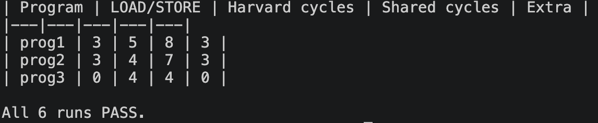
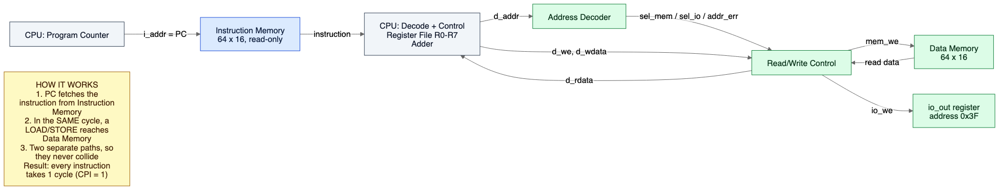
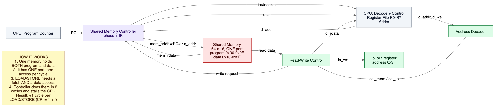
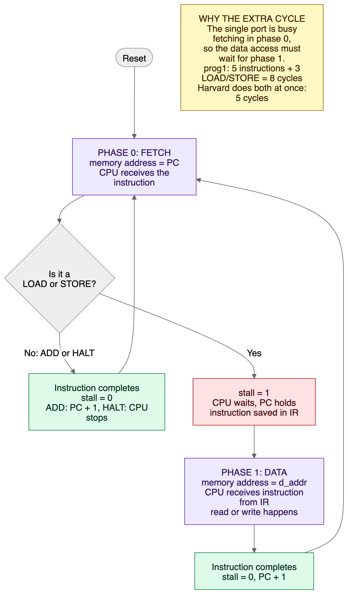
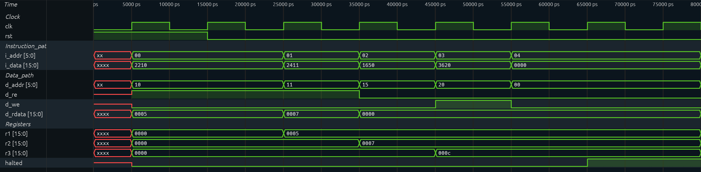
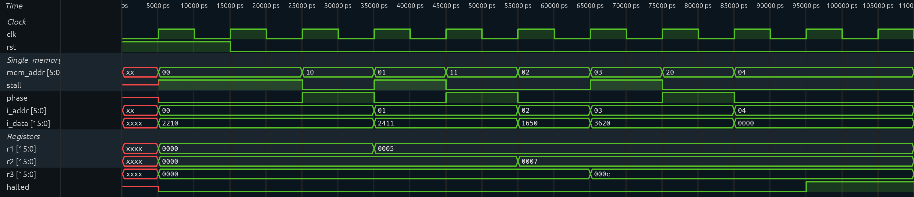
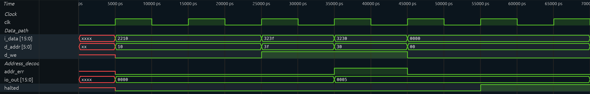

<div align="center">

# DualPath

### Harvard vs Shared-Memory Organization: a cycle-accurate comparison in Verilog

*One CPU. Two memory systems. Same programs. Every extra clock cycle measured, explained and on the waveform.*


**[Results](#key-result)** · **[Block Diagrams](#block-diagrams)** · **[Waveforms](#simulation-waveforms)** · **[Quick Start](#quick-start)** · **[Team](#team-and-contributions)**

</div>

---

```
 HARVARD                                  SHARED MEMORY (von Neumann)
 ┌─────┐  instr  ┌──────────────┐         ┌─────┐        ┌────────────┐  ONE  ┌─────────────┐
 │     │◄────────┤ Instr Memory │         │     │◄──────►│ Controller │◄─────►│   Memory    │
 │ CPU │         └──────────────┘         │ CPU │ stall  │ fetch|data │ port  │ code + data │
 │     │  data   ┌──────────────┐         │     │◄───────┤            │       └─────────────┘
 │     │◄───────►│ Data Memory  │         └─────┘        └────────────┘
 └─────┘         └──────────────┘
 fetch + data in the SAME cycle           fetch, THEN data: +1 cycle per LOAD/STORE
```

---

## Table of Contents

1. [Overview](#overview)
2. [Project Brief and Deliverables](#project-brief-and-deliverables)
3. [Key Result](#key-result)
4. [Block Diagrams](#block-diagrams)
5. [Simulation Waveforms](#simulation-waveforms)
6. [The CPU](#the-cpu)
7. [Memory Organization](#memory-organization)
8. [Cycle-by-Cycle Timing](#cycle-by-cycle-timing)
9. [Quick Start](#quick-start)
10. [Usage](#usage)
11. [Viewing the Waveforms Yourself](#viewing-the-waveforms-yourself)
12. [Verification](#verification)
13. [Repository Structure](#repository-structure)
14. [Design Decisions](#design-decisions)
15. [Limitations and Future Work](#limitations-and-future-work)
16. [Team and Contributions](#team-and-contributions)

---

## Overview

Every processor does two kinds of memory access: it **fetches instructions** and it **reads or
writes data**. Where those two live decides how fast the processor can go.

| | **Von Neumann (shared memory)** | **Harvard** |
|---|---|---|
| Memories | One memory holds both program and data | Separate instruction memory and data memory |
| Ports | One port: one access per cycle | Two independent paths |
| LOAD / STORE | Fetch first, data in the next cycle (**stall**) | Fetch and data access in the **same** cycle |
| Program safety | A STORE can overwrite instructions | A STORE can never reach instructions |
| Flexibility | Memory can be split between code and data freely | Fixed split between code and data |
| Typical use | General-purpose main memory | Microcontrollers (AVR, PIC), DSPs, split L1 caches |

**DualPath** builds both organizations around the **same** single-cycle 16-bit CPU and runs the
**same** programs on each, so the memory organization is the only variable. The stall is not
assumed or calculated: it comes out of real RTL and is visible in the waveforms below.

---

## Project Brief and Deliverables

> **Project 9: Instruction and Data Memory Hierarchy** *(Intermediate)*
>
> **Objective:** Implement a simplified Harvard-style memory organization with separate
> instruction and data paths and analyze its behavior.

| Brief requirement | Delivered | Where |
|---|:---:|---|
| Program Counter | ✅ | [`rtl/program_counter.v`](rtl/program_counter.v) |
| Instruction Memory | ✅ | [`rtl/instruction_memory.v`](rtl/instruction_memory.v) |
| Data Memory | ✅ | [`rtl/data_memory.v`](rtl/data_memory.v) |
| Address Decoder | ✅ | [`rtl/address_decoder.v`](rtl/address_decoder.v) |
| Read/Write Control | ✅ | [`rtl/rw_control.v`](rtl/rw_control.v) |
| Independent instruction and data paths | ✅ | [`rtl/harvard_top.v`](rtl/harvard_top.v) |
| Connect to a simple processor | ✅ | [`rtl/cpu.v`](rtl/cpu.v) |
| Execute programs with fetches and data accesses | ✅ | [`programs/`](programs/), [`tb/`](tb/) |
| Analyze simultaneous access opportunities | ✅ | [Waveforms](#simulation-waveforms), [Timing](#cycle-by-cycle-timing) |
| **Deliverable:** Harvard memory RTL | ✅ | [`rtl/`](rtl/) |
| **Deliverable:** Block diagram | ✅ | [`docs/diagrams/`](docs/diagrams/) |
| **Deliverable:** Simulation waveforms | ✅ | [`docs/waveforms/`](docs/waveforms/) |
| **Deliverable:** Comparison with shared memory | ✅ | [`rtl/shared_top.v`](rtl/shared_top.v), [Key Result](#key-result) |

| Evaluation focus | How this project demonstrates it |
|---|---|
| Correct instruction/data separation | Separate memories in Harvard; instruction memory has no write port |
| Memory control | Address decoder, read/write control, `addr_err`, memory-mapped `io_out` (prog2) |
| Timing behavior | Cycle-accurate waveforms: same-cycle access vs fetch-then-data stall |
| Architecture comparison | Same CPU and programs on both systems: 5 vs 8, 4 vs 7, 4 vs 4 cycles |

---

## Key Result

<div align="center">

### `shared cycles = Harvard cycles + number of LOAD/STOREs`

</div>

| Program | What it does | LOAD/STORE | Harvard cycles | Shared cycles | Extra | Slowdown |
|---|---|:---:|:---:|:---:|:---:|:---:|
| `prog1` | Load two numbers, add, store the sum | 3 | **5** | **8** | +3 | 1.60× |
| `prog2` | Address-decoder test (I/O + unmapped) | 3 | **4** | **7** | +3 | 1.75× |
| `prog3` | Arithmetic only (control case) | 0 | **4** | **4** | 0 | 1.00× |

<p align="center">
  
  <br><sub><code>make compare</code>: all three programs on both systems, all 6 runs pass</sub>
</p>

> **Takeaway.** The shared-memory system pays exactly **one stall cycle per data access**.
> With zero data accesses (`prog3`) both systems are identical, which proves the difference
> comes from the memory organization alone. In general,
> **CPI<sub>Harvard</sub> = 1** and **CPI<sub>shared</sub> = 1 + f**, where *f* is the fraction of
> instructions that access data.

---

## Block Diagrams

### 1. Harvard system

<p align="center">
  
</p>

- **Instruction path (blue):** the Program Counter addresses the read-only Instruction Memory; the instruction goes straight to the CPU.
- **Data path (green):** the CPU's data address goes through the Address Decoder and Read/Write Control to the Data Memory or the `io_out` register.
- **Why it is fast:** the two paths are physically separate, so a LOAD/STORE fetches its instruction and accesses its data **in the same clock cycle**. The CPU's `stall` input is tied to 0.

Source: [`rtl/harvard_top.v`](rtl/harvard_top.v)

### 2. Shared-memory system

<p align="center">
  
</p>

- **One memory, one port (red):** program (`0x00`–`0x0F`) and data (`0x10`–`0x2F`) live in the same 64 × 16 array, reachable through **exactly one** address/data port.
- **Controller (purple):** chooses what the port serves each cycle (the PC for a fetch, or `d_addr` for a data access) and raises `stall` when both are needed.
- **Same CPU:** the CPU RTL is identical to the Harvard system; only its `stall` input is now driven.

Source: [`rtl/shared_top.v`](rtl/shared_top.v)

### 3. Shared-memory controller flow

<p align="center">
  
</p>

| Phase | Memory address | Instruction given to CPU | Write allowed | `stall` |
|---|---|---|---|---|
| **0: Fetch** | `PC` | memory output | no | 1 if LOAD/STORE, else 0 |
| **1: Data** | `d_addr` | saved instruction register `IR` | yes | 0 |

Source: [`rtl/shared_mem_controller.v`](rtl/shared_mem_controller.v)

---

## Simulation Waveforms

Captured with [Surfer](https://surfer-project.org/) from the VCD files produced by the
testbenches. Values are hexadecimal; `000c` = 12.

### Harvard, `prog1`: fetch and data in the same cycle (5 cycles)

<p align="center">
  
</p>

| What to look at | What it shows |
|---|---|
| `i_addr` = 00 while `d_addr` = 10, `d_re` = 1 | The first LOAD is fetched **and** reads its data in the **same** cycle |
| `i_addr` = 03 while `d_addr` = 20, `d_we` = 1 | The STORE writes data memory in the same cycle it is fetched |
| `r1` = 0005, `r2` = 0007, `r3` = 000c | 5 + 7 = 12, computed correctly |
| `halted` rises after 5 cycles | One cycle per instruction: **CPI = 1** |

### Shared memory, `prog1`: one port taking turns (8 cycles)

<p align="center">
  
</p>

| What to look at | What it shows |
|---|---|
| `mem_addr`: 00 → 10 → 01 → 11 → 02 → 03 → 20 → 04 | The single port serves the PC, then the data address, then the next PC |
| `stall` = 1 while `mem_addr` = PC of a LOAD/STORE | The CPU waits because the port is busy fetching |
| `phase` = 1 in the following cycle | The data access happens one cycle later |
| `mem_addr` = 02 with no stall | ADD needs no data, so it completes in one cycle |
| `halted` rises after 8 cycles | 5 instructions + 3 stalls = **8 cycles** |

### Harvard, `prog2`: address decoding and memory-mapped output

<p align="center">
  
</p>

| What to look at | What it shows |
|---|---|
| `d_addr` = 3f with `d_we` = 1, then `io_out` = 0005 | A STORE to `0x3F` reaches the output register (memory-mapped I/O) |
| `d_addr` = 30 with `d_we` = 1, `addr_err` = 1 | A STORE to an unmapped address is flagged and ignored |
| `addr_err` low on every other cycle | The error only fires on a real LOAD/STORE to an unmapped address |

---

## The CPU

A deliberately minimal **single-cycle** processor: fetch, decode, execute and write-back in one
clock cycle. The **same** [`cpu.v`](rtl/cpu.v) is used in both systems.

| Parameter | Value |
|---|---|
| Data / instruction width | 16 bits |
| Registers | 8 × 16-bit (`R0`–`R7`), `R0` hard-wired to 0 |
| Address space | 6 bits (`0x00`–`0x3F`), word-addressed |
| Program counter | +1 per completed instruction |
| Data address | `(R[rs1] + imm6)[5:0]` |
| Stall behavior | PC holds, no register write, no memory write |

### Instruction set

| Opcode | Mnemonic | Operation |
|:---:|---|---|
| `0` | `HALT` | Stop: `halted` = 1, PC freezes |
| `1` | `ADD rd, rs1, rs2` | `R[rd] = R[rs1] + R[rs2]` |
| `2` | `LOAD rd, [rs1 + imm6]` | `R[rd] = MEM[R[rs1] + imm6]` |
| `3` | `STORE rs2, [rs1 + imm6]` | `MEM[R[rs1] + imm6] = R[rs2]` |
| `4`–`15` | *unused* | Treated as `HALT` |

### Encoding

```
  15    12 11     9 8      6 5      3 2      0
 +--------+--------+--------+--------+--------+
 |  0001  |   rd   |  rs1   |  rs2   |  000   |   ADD
 +--------+--------+--------+--------+--------+
 |  0010  |   rd   |  rs1   |      imm6       |   LOAD
 +--------+--------+--------+-----------------+
 |  0011  |  rs2   |  rs1   |      imm6       |   STORE  (rs2 = value, rs1 = base)
 +--------+--------+--------+-----------------+
 |  0000  |  000   |  000   |     000000      |   HALT = 0x0000
 +--------+--------+--------+-----------------+
```

### CPU interface

| Port | Dir | Width | Meaning |
|---|:---:|:---:|---|
| `clk` | in | 1 | Clock |
| `rst` | in | 1 | Synchronous, active-high reset |
| `stall` | in | 1 | 1 = PC holds, no register write, no memory write |
| `i_addr` | out | 6 | Instruction address (= PC) |
| `i_data` | in | 16 | Instruction |
| `d_addr` | out | 6 | Data address |
| `d_re` | out | 1 | 1 for LOAD |
| `d_we` | out | 1 | 1 for STORE (forced 0 while stalled) |
| `d_wdata` | out | 16 | Data to write |
| `d_rdata` | in | 16 | Data read |
| `halted` | out | 1 | 1 after HALT executes |

---

## Memory Organization

### Data address map (identical in both systems)

| Address | Target | Behavior |
|---|---|---|
| `0x00`–`0x0F` | Memory | Program area (in shared memory) |
| `0x10`–`0x2F` | Memory | Data area |
| `0x30`–`0x3E` | *Unmapped* | `addr_err` = 1, write ignored, read returns 0 |
| `0x3F` | `io_out` register | Memory-mapped output port |

### Memories

| Module | System | Size | Ports | Read | Write | Loaded from |
|---|---|---|---|---|---|---|
| [`instruction_memory`](rtl/instruction_memory.v) | Harvard | 64 × 16 | 1 read | async | none (ROM) | `progN.hex` |
| [`data_memory`](rtl/data_memory.v) | Harvard | 64 × 16 | 1 read/write | async | rising edge | `progN_data.hex` (`@10`) |
| [`shared_memory`](rtl/shared_memory.v) | Shared | 64 × 16 | **exactly 1** | async | rising edge | both files |

All memories are zero-filled before loading, and `0x0000` decodes as `HALT`, so running past
the end of a program stops the CPU safely.

> **Separation in action.** In the Harvard system a STORE physically cannot reach instruction
> memory: it has no write port. In the shared system program and data share one array, so a
> STORE to `0x00`–`0x0F` *would* overwrite code.

---

## Cycle-by-Cycle Timing

Traced from the simulation of `prog1`, and matching the waveforms above.

<table>
<tr><th>Harvard: 5 cycles</th><th>Shared memory: 8 cycles</th></tr>
<tr><td valign="top">

| Cycle | Instruction | Instr. mem | Data mem |
|:---:|---|:---:|:---:|
| 1 | `LOAD R1, [R0+16]` | 0 | **read 0x10** |
| 2 | `LOAD R2, [R0+17]` | 1 | **read 0x11** |
| 3 | `ADD R3, R1, R2` | 2 | idle |
| 4 | `STORE R3, [R0+32]` | 3 | **write 0x20** |
| 5 | `HALT` | 4 | idle |

</td><td valign="top">

| Cycle | Phase | Port address | `stall` | Effect |
|:---:|:---:|:---:|:---:|---|
| 1 | fetch | `0x00` | **1** | LOAD R1 waits |
| 2 | data | `0x10` | 0 | R1 ← 5 |
| 3 | fetch | `0x01` | **1** | LOAD R2 waits |
| 4 | data | `0x11` | 0 | R2 ← 7 |
| 5 | fetch | `0x02` | 0 | R3 ← 12 (ADD) |
| 6 | fetch | `0x03` | **1** | STORE waits |
| 7 | data | `0x20` | 0 | MEM[0x20] ← 12 |
| 8 | fetch | `0x04` | 0 | HALT |

</td></tr>
</table>

Harvard overlaps fetch and data in cycles 1, 2 and 4. The shared port serves **either** a fetch
**or** a data access, never both, hence one stall per LOAD/STORE.

---

## Quick Start

### Prerequisites

| Tool | Purpose | macOS (Apple Silicon) | Ubuntu / Debian |
|---|---|---|---|
| Icarus Verilog (tested with 13.0) | Compile and simulate | `brew install icarus-verilog` | `sudo apt install iverilog` |
| GNU Make | Run the shortcuts | preinstalled | `sudo apt install make` |
| Surfer *(recommended on macOS)* | View waveforms | `brew install surfer` | see [surfer-project.org](https://surfer-project.org/) |
| GTKWave *(alternative)* | View waveforms | `brew install --HEAD randomplum/gtkwave/gtkwave` (community tap) | `sudo apt install gtkwave` |

> The old `brew install --cask gtkwave` no longer works: that cask was removed from Homebrew.

### Run it

```sh
git clone https://github.com/rajdeep-2004/dualpath.git
cd dualpath
make compare
```

---

## Usage

| Command | What it does |
|---|---|
| `make compare` | Runs all 3 programs on both systems, prints the comparison table, fails if any check fails |
| `make harvard PROG=prog1` | Runs one program (`prog1`, `prog2`, `prog3`) on the Harvard system |
| `make shared PROG=prog1` | Runs one program on the shared-memory system |
| `make clean` | Deletes `sim/` (all generated output) |
| `make help` | Lists the commands |

```text
$ make harvard PROG=prog1
harvard prog1: PASS | cycles=5 load_store=3 fetch+data_same_cycle=3

$ make shared PROG=prog1
shared prog1: PASS | cycles=8 load_store=3 stall_cycles=3

$ make harvard PROG=prog9
Unknown PROG=prog9. Use one of: prog1 prog2 prog3
```

---

## Viewing the Waveforms Yourself

Every run writes a VCD (Value Change Dump) file to `sim/`:

```
sim/harvard_prog1.vcd   sim/harvard_prog2.vcd   sim/harvard_prog3.vcd
sim/shared_prog1.vcd    sim/shared_prog2.vcd    sim/shared_prog3.vcd
```

1. Open one: `surfer sim/harvard_prog1.vcd` (or `gtkwave sim/harvard_prog1.vcd`).
2. In the scope tree, expand `tb_harvard` → `dut` (or `tb_shared` → `dut`).
3. Add the signals for the view you want:

| View | Signals |
|---|---|
| Harvard `prog1` | `clk`, `rst`, `i_addr`, `i_data`, `d_addr`, `d_re`, `d_we`, `d_rdata`, `u_cpu.u_rf.r1`–`r3`, `halted` |
| Shared `prog1` | `clk`, `rst`, `mem_addr`, `stall`, `phase`, `i_addr`, `i_data`, `u_cpu.u_rf.r1`–`r3`, `halted` |
| Harvard `prog2` | `clk`, `i_data`, `d_addr`, `d_we`, `addr_err`, `io_out`, `halted` |

4. Zoom to fit. Right-click a signal to change its display format (hex, decimal).

---

## Verification

Each testbench is **self-checking**: it resets the system, runs until `halted` (failing after
200 cycles), compares the final state with expected values and prints `PASS` or `FAIL` with the
exact mismatch.

| Program | Checks |
|---|---|
| `prog1` | R1 = 5, R2 = 7, R3 = 12, MEM[0x20] = 12, cycle count |
| `prog2` | `io_out` = 5, `addr_err` seen, MEM[0x30] and MEM[0x3F] untouched, cycle count |
| `prog3` | R1 = R2 = R3 = 0, cycle count |

The checks catch real bugs: replacing the adder with a subtractor makes `prog1` fail with
`FAIL R3: got 65534, expected 12`, and `make compare` exits with an error.

### Test programs

<details>
<summary><b>prog1</b>: main demo</summary>

| Addr | Instruction | Hex |
|:---:|---|:---:|
| 0 | `LOAD R1, [R0+16]` | `2210` |
| 1 | `LOAD R2, [R0+17]` | `2411` |
| 2 | `ADD R3, R1, R2` | `1650` |
| 3 | `STORE R3, [R0+32]` | `3620` |
| 4 | `HALT` | `0000` |

Data at `0x10`: `0005`, `0007`.
</details>

<details>
<summary><b>prog2</b>: address decoder test</summary>

| Addr | Instruction | Hex |
|:---:|---|:---:|
| 0 | `LOAD R1, [R0+16]` | `2210` |
| 1 | `STORE R1, [R0+63]` → `io_out` | `323F` |
| 2 | `STORE R1, [R0+48]` → unmapped | `3230` |
| 3 | `HALT` | `0000` |

Data at `0x10`: `0005`.
</details>

<details>
<summary><b>prog3</b>: no memory access (control case)</summary>

| Addr | Instruction | Hex |
|:---:|---|:---:|
| 0 | `ADD R1, R0, R0` | `1200` |
| 1 | `ADD R2, R1, R1` | `1448` |
| 2 | `ADD R3, R2, R2` | `1690` |
| 3 | `HALT` | `0000` |

No data.
</details>

---

## Repository Structure

```
dualpath/
├── rtl/                          # Synthesizable design (Verilog-2001)
│   ├── program_counter.v         # PC: +1 per instruction, holds on stall/halt
│   ├── register_file.v           # 8 x 16-bit, 2 read ports, 1 write port, R0 = 0
│   ├── cpu.v                     # Single-cycle CPU: decode, control, adder, stall input
│   ├── address_decoder.v         # addr -> sel_mem / sel_io / addr_err
│   ├── rw_control.v              # Routes write enables and read data
│   ├── io_reg.v                  # Memory-mapped output register (0x3F)
│   ├── instruction_memory.v      # Harvard: 64 x 16 ROM
│   ├── data_memory.v             # Harvard: 64 x 16 RAM
│   ├── harvard_top.v             # Harvard system top level
│   ├── shared_memory.v           # Shared: 64 x 16, ONE port
│   ├── shared_mem_controller.v   # Fetch/data phases, IR, stall
│   └── shared_top.v              # Shared-memory system top level
├── tb/
│   ├── tb_harvard.v              # Self-checking testbench (Harvard)
│   └── tb_shared.v               # Self-checking testbench (shared)
├── programs/                     # Hand-assembled programs and data (hex)
├── docs/
│   ├── diagrams/                 # Block diagrams and controller flow (PNG)
│   ├── waveforms/                # Simulation waveform captures (PNG)
│   └── decisions.md              # Design decisions and their reasons
├── Makefile                      # harvard / shared / compare / clean / help
└── sim/                          # Generated: .vvp and .vcd (git-ignored)
```

RTL rules followed throughout `rtl/`: Verilog-2001 only, synchronous active-high reset, no `#`
delays, no `$display`. Simulation-only code lives in `tb/`.

---

## Design Decisions

The full reasoning is in [`docs/decisions.md`](docs/decisions.md).

| Decision | Why |
|---|---|
| **Single-cycle CPU** | A multi-cycle CPU would hide the port conflict inside its own extra cycles, and both systems would take equal time. Single-cycle makes the conflict visible. |
| **Same CPU in both systems** | The memory organization is the only variable; the `stall` input is the single point of difference. |
| **Shared memory has exactly one port** | A second port would turn it back into a Harvard-like design. |
| **Controller decodes the opcode itself** | Using the CPU's `d_we` would form a combinational loop, because `d_we` is forced to 0 while `stall` = 1. |
| **`halted` is a register** | A clean, well-defined cycle count that includes the HALT instruction. |
| **`addr_err` only on real accesses** | ADD instructions also produce an address from their bit fields; gating with `d_re \| d_we` prevents false errors. |
| **Asynchronous memory reads** | Lets fetch and data return within the same cycle, which a single-cycle CPU needs. |
| **Zero-filled memories, unused opcodes = HALT** | Running past the end of a program stops safely instead of executing garbage. |

---

## Limitations and Future Work

| Limitation | Possible extension |
|---|---|
| Four instructions; no branches, immediates or subtraction | Add `BEQ`/`JMP` and `ADDI` to run loops |
| 64-word address space, behavioral memories | Larger memories, synchronous SRAM models |
| Simulation only | Synthesize to an FPGA, drive LEDs from `io_out` |
| `prog3` can only produce zeros (no immediate instruction) | An `ADDI` would make the control case compute real values |
| No demonstration of code being overwritten in shared memory | A program that STOREs into `0x00`–`0x0F` to show self-modifying code |
| No caches | Split instruction/data caches over the shared memory (modified Harvard) |

---

## Team and Contributions

| Member | GitHub | Area | Modules | Responsibilities |
|---|---|---|---|---|
| **Rajat Srivastav** | [@rajatrsrivastav](https://github.com/rajatrsrivastav) | CPU state | `register_file.v`, `program_counter.v` | 8 × 16 register file with R0 = 0, two read ports and synchronous write; program counter with enable for stall and halt |
| **Sachin** | [@jaiswalsachin49](https://github.com/jaiswalsachin49) | Processor core | `cpu.v` | Instruction decode, control signals, adder and address generation, `stall` handling, HALT logic |
| **Anand** | [@anand24mishra](https://github.com/anand24mishra) | Memory control | `address_decoder.v`, `rw_control.v`, `io_reg.v` | Address map decoding, `addr_err`, write-enable routing, read-data selection, memory-mapped output |
| **Rajdeep** | [@rajdeep-2004](https://github.com/rajdeep-2004) | Harvard system and integration | `instruction_memory.v`, `data_memory.v`, `harvard_top.v`, `tb_harvard.v`, `programs/`, `Makefile`, docs | Separate instruction/data memories, Harvard top-level integration, self-checking testbench, test programs, build flow, diagrams, waveforms and documentation |
| **Omved Nagre** | [@OmvedNagre](https://github.com/OmvedNagre) | Shared-memory system | `shared_memory.v`, `shared_mem_controller.v`, `shared_top.v`, `tb_shared.v` | Single-port shared memory, fetch/data phase controller with stall, shared top level, testbench and comparison |

---

<div align="center">

**Modern Computer Architecture · Capstone Project 9 · Instruction and Data Memory Hierarchy**

<sub>Harvard: two roads, no waiting. Shared: one road, take turns.</sub>

</div>
