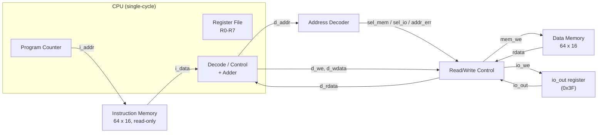
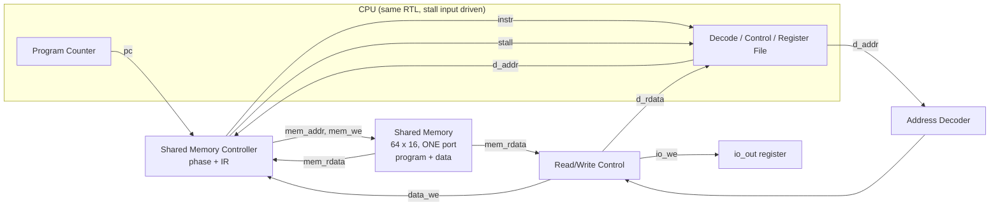
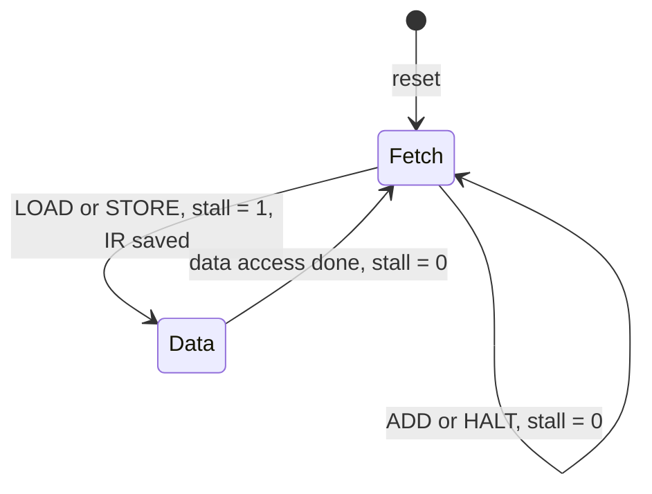

<div align="center">

# DualPath

### Harvard vs Shared-Memory Organization: a cycle-accurate comparison in Verilog

*One CPU. Two memory systems. Same programs. Every extra clock cycle explained.*


</div>

---

## Table of Contents

1. [Overview](#overview)
2. [Key Result](#key-result)
3. [Architecture](#architecture)
4. [The CPU](#the-cpu)
5. [Memory Organization](#memory-organization)
6. [Cycle-by-Cycle Timing](#cycle-by-cycle-timing)
7. [Getting Started](#getting-started)
8. [Usage](#usage)
9. [Viewing Waveforms](#viewing-waveforms)
10. [Verification](#verification)
11. [Repository Structure](#repository-structure)
12. [Design Decisions](#design-decisions)
13. [Limitations](#limitations)
14. [Team and Contributions](#team-and-contributions)

---

## Overview

Every processor must fetch **instructions** and read or write **data**. Where those two live
decides how fast the processor can go.

| | **Von Neumann (shared memory)** | **Harvard** |
|---|---|---|
| Memories | One memory holds both program and data | Separate instruction memory and data memory |
| Ports | One port: one access per cycle | Two independent paths |
| LOAD / STORE | Fetch first, data next cycle (**stall**) | Fetch and data access in the **same** cycle |
| Program safety | A STORE can overwrite instructions | A STORE can never touch instructions |
| Typical use | General-purpose main memory | Microcontrollers, DSPs, L1 split caches |

**DualPath** builds both organizations around the *same* single-cycle 16-bit CPU and runs the
same programs on each, so the only variable is the memory organization. The stall is not
assumed or calculated: it is produced by real RTL and is visible in the waveforms.

**Project objectives (Project 9):**
- Implement a simplified Harvard memory organization with separate instruction and data paths
- Build the modules: Program Counter, Instruction Memory, Data Memory, Address Decoder, Read/Write Control
- Connect them to a simple processor and execute programs with instruction fetches and data accesses
- Analyze simultaneous access opportunities and compare with a shared-memory organization

---

## Key Result

```
shared cycles = Harvard cycles + number of LOAD/STORE instructions
```

| Program | What it does | LOAD/STORE | Harvard cycles | Shared cycles | Extra | Slowdown |
|---|---|:---:|:---:|:---:|:---:|:---:|
| `prog1` | Load two numbers, add, store | 3 | **5** | **8** | +3 | 1.60× |
| `prog2` | Address-decoder test (I/O + unmapped) | 3 | **4** | **7** | +3 | 1.75× |
| `prog3` | Arithmetic only (control case) | 0 | **4** | **4** | 0 | 1.00× |

> **Takeaway:** the shared-memory system pays exactly **one stall cycle per data access**.
> When a program does no data access (`prog3`), both systems are identical, which proves the
> difference comes from the memory organization alone.

---

## Architecture

### Harvard system (`rtl/harvard_top.v`)

Two independent paths. The CPU fetches an instruction **and** accesses data in the same cycle.



### Shared-memory system (`rtl/shared_top.v`)

One memory, **one port**. A controller takes turns between fetch and data access and stalls the
CPU when both are needed.



### Controller state machine (`rtl/shared_mem_controller.v`)



| Phase | Memory address | Instruction to CPU | Write allowed | `stall` |
|---|---|---|---|---|
| 0: Fetch | `PC` | memory output | no | 1 if LOAD/STORE, else 0 |
| 1: Data | `d_addr` | saved `IR` | yes | 0 |

---

## The CPU

A deliberately minimal **single-cycle** processor: fetch, decode, execute and write-back all in
one clock cycle. The *same* `cpu.v` is used in both systems; only its `stall` input differs
(tied to `0` in Harvard, driven by the controller in shared).

| Parameter | Value |
|---|---|
| Data / instruction width | 16 bits |
| Registers | 8 × 16-bit (`R0`–`R7`), `R0` hard-wired to 0 |
| Address space | 6 bits (`0x00`–`0x3F`), word-addressed |
| PC | +1 per completed instruction |
| Data address | `(R[rs1] + imm6)[5:0]` |

### Instruction set

| Opcode | Mnemonic | Operation |
|:---:|---|---|
| `0` | `HALT` | Stop: `halted` = 1, PC freezes |
| `1` | `ADD rd, rs1, rs2` | `R[rd] = R[rs1] + R[rs2]` |
| `2` | `LOAD rd, [rs1 + imm6]` | `R[rd] = MEM[R[rs1] + imm6]` |
| `3` | `STORE rs2, [rs1 + imm6]` | `MEM[R[rs1] + imm6] = R[rs2]` |
| `4`–`15` | *unused* | Treated as `HALT` |

### Encoding

```
  15    12 11     9 8      6 5      3 2      0
 +--------+--------+--------+--------+--------+
 | opcode |   rd   |  rs1   |  rs2   |  000   |   ADD
 +--------+--------+--------+--------+--------+
 | opcode |   rd   |  rs1   |      imm6       |   LOAD
 +--------+--------+--------+-----------------+
 | opcode |  rs2   |  rs1   |      imm6       |   STORE  (rs2 = value, rs1 = base)
 +--------+--------+--------+-----------------+
 |  0000  |  000   |  000   |     000000      |   HALT = 0x0000
 +--------+--------+--------+-----------------+
```

### CPU interface (`rtl/cpu.v`)

| Port | Dir | Width | Meaning |
|---|:---:|:---:|---|
| `clk` | in | 1 | Clock |
| `rst` | in | 1 | Synchronous, active-high reset |
| `stall` | in | 1 | 1 = PC holds, no register write, no memory write |
| `i_addr` | out | 6 | Instruction address (= PC) |
| `i_data` | in | 16 | Instruction |
| `d_addr` | out | 6 | Data address |
| `d_re` | out | 1 | 1 for LOAD |
| `d_we` | out | 1 | 1 for STORE (forced 0 while stalled) |
| `d_wdata` | out | 16 | Data to write |
| `d_rdata` | in | 16 | Data read |
| `halted` | out | 1 | 1 after HALT executes |

---

## Memory Organization

### Data address map (identical in both systems)

| Address | Target | Behavior |
|---|---|---|
| `0x00`–`0x0F` | Memory | Program area (in shared memory) |
| `0x10`–`0x2F` | Memory | Data area |
| `0x30`–`0x3E` | *Unmapped* | `addr_err` = 1, write ignored, read returns 0 |
| `0x3F` | `io_out` register | Memory-mapped output port |

### Memories

| Module | System | Size | Ports | Read | Write | Loaded from |
|---|---|---|---|---|---|---|
| `instruction_memory` | Harvard | 64 × 16 | 1 read | async | none (ROM) | `progN.hex` |
| `data_memory` | Harvard | 64 × 16 | 1 read/write | async | rising edge | `progN_data.hex` (`@10`) |
| `shared_memory` | Shared | 64 × 16 | **exactly 1** | async | rising edge | both files |

All memories are zero-filled before loading, and `0x0000` decodes as `HALT`, so running past
the end of a program stops the CPU safely.

> **Separation in action:** in the Harvard system a STORE physically cannot reach instruction
> memory. In the shared system the program and data live in the same array, so a STORE to
> `0x00`–`0x0F` *would* overwrite code (self-modifying code, or a bug).

---

## Cycle-by-Cycle Timing

Traced from the simulation of `prog1`. Values are shown during each cycle; register results
appear at the next rising edge.

### Harvard: 5 cycles

| Cycle | PC | Instruction | Instruction memory | Data memory | Effect |
|:---:|:---:|---|:---:|:---:|---|
| 1 | 0 | `LOAD R1, [R0+16]` (`2210`) | addr 0 | **addr 0x10 read** | R1 ← 5 |
| 2 | 1 | `LOAD R2, [R0+17]` (`2411`) | addr 1 | **addr 0x11 read** | R2 ← 7 |
| 3 | 2 | `ADD R3, R1, R2` (`1650`) | addr 2 | idle | R3 ← 12 |
| 4 | 3 | `STORE R3, [R0+32]` (`3620`) | addr 3 | **addr 0x20 write** | MEM[0x20] ← 12 |
| 5 | 4 | `HALT` (`0000`) | addr 4 | idle | halted |

Fetch and data access happen **together** in cycles 1, 2 and 4.

### Shared memory: 8 cycles

| Cycle | Phase | Memory address | `stall` | Instruction | Effect |
|:---:|:---:|:---:|:---:|---|---|
| 1 | Fetch | `0x00` (PC) | **1** | `LOAD R1` | saved in IR, CPU waits |
| 2 | Data | `0x10` | 0 | `LOAD R1` (from IR) | R1 ← 5 |
| 3 | Fetch | `0x01` (PC) | **1** | `LOAD R2` | CPU waits |
| 4 | Data | `0x11` | 0 | `LOAD R2` | R2 ← 7 |
| 5 | Fetch | `0x02` (PC) | 0 | `ADD` | R3 ← 12 (no data access, no stall) |
| 6 | Fetch | `0x03` (PC) | **1** | `STORE R3` | CPU waits |
| 7 | Data | `0x20` | 0 | `STORE R3` | MEM[0x20] ← 12 |
| 8 | Fetch | `0x04` (PC) | 0 | `HALT` | halted |

The single port serves **either** a fetch **or** a data access, never both, hence one stall per
LOAD/STORE.

---

## Getting Started

### Prerequisites

| Tool | Purpose | macOS (Apple Silicon) | Ubuntu / Debian |
|---|---|---|---|
| Icarus Verilog (tested with 13.0) | Compile and simulate | `brew install icarus-verilog` | `sudo apt install iverilog` |
| GNU Make | Run the shortcuts | preinstalled | `sudo apt install make` |
| Surfer *(recommended on macOS)* | View waveforms | `brew install surfer` | see [surfer-project.org](https://surfer-project.org/) |
| GTKWave *(alternative)* | View waveforms | `brew install --HEAD randomplum/gtkwave/gtkwave` (community tap) | `sudo apt install gtkwave` |

> The old `brew install --cask gtkwave` no longer works: that cask was removed from Homebrew.

### Clone and run

```sh
git clone https://github.com/rajdeep-2004/dualpath.git
cd dualpath
make compare
```

---

## Usage

| Command | What it does |
|---|---|
| `make compare` | Runs all 3 programs on both systems, prints the comparison table, fails if any check fails |
| `make harvard PROG=prog1` | Runs one program (`prog1`, `prog2`, `prog3`) on the Harvard system |
| `make shared PROG=prog1` | Runs one program on the shared-memory system |
| `make clean` | Deletes `sim/` (all generated output) |
| `make help` | Lists the commands |

### Example output

```text
$ make harvard PROG=prog1
harvard prog1: PASS | cycles=5 load_store=3 fetch+data_same_cycle=3

$ make shared PROG=prog1
shared prog1: PASS | cycles=8 load_store=3 stall_cycles=3

$ make compare
| Program | LOAD/STORE | Harvard cycles | Shared cycles | Extra |
|---|---|---|---|---|
| prog1 | 3 | 5 | 8 | 3 |
| prog2 | 3 | 4 | 7 | 3 |
| prog3 | 0 | 4 | 4 | 0 |

All 6 runs PASS.
```

---

## Viewing Waveforms

Every run writes a VCD (Value Change Dump) file to `sim/`:

```
sim/harvard_prog1.vcd   sim/harvard_prog2.vcd   sim/harvard_prog3.vcd
sim/shared_prog1.vcd    sim/shared_prog2.vcd    sim/shared_prog3.vcd
```

Open one with `surfer sim/harvard_prog1.vcd` (or `gtkwave sim/harvard_prog1.vcd`), expand
`tb_harvard` → `dut` (or `tb_shared` → `dut`) and add these signals:

| Signal | Where | Why it matters |
|---|---|---|
| `clk`, `rst` | `dut` | Timing reference |
| `i_addr`, `i_data` | `dut` | PC and the fetched instruction |
| `d_addr`, `d_re`, `d_we`, `d_wdata`, `d_rdata` | `dut` | Data-side activity |
| `addr_err` | `dut` | Unmapped access flag (`prog2`) |
| `stall`, `phase`, `mem_addr` | `dut` (shared only) | The single port taking turns |
| `r1`, `r2`, `r3` | `dut.u_cpu.u_rf` | Register results |
| `io_out`, `halted` | `dut` | Output port and end of program |

**What to look for**
- **Harvard `prog1`:** during each LOAD/STORE, `i_addr` and `d_addr` are both active in the same cycle.
- **Shared `prog1`:** `mem_addr` = PC while `stall` = 1, then `mem_addr` = data address in the next cycle (`phase` = 1).
- **`prog2`:** `addr_err` pulses high during the STORE to `0x30`; `io_out` becomes 5.

---

## Verification

Each testbench is **self-checking**: it resets the system, runs until `halted` (or fails after
200 cycles), compares the final state with the expected values and prints `PASS` or `FAIL` with
the exact mismatch.

| Program | Checks |
|---|---|
| `prog1` | R1 = 5, R2 = 7, R3 = 12, MEM[0x20] = 12, cycle count |
| `prog2` | `io_out` = 5, `addr_err` seen, MEM[0x30] and MEM[0x3F] untouched, cycle count |
| `prog3` | R1 = R2 = R3 = 0, cycle count |

Expected cycle counts are fixed by design (5/4/4 Harvard, 8/7/4 shared). The checks catch real
bugs: replacing the adder with a subtractor makes `prog1` fail with
`FAIL R3: got 65534, expected 12`.

### Test programs (`programs/`)

<details>
<summary><b>prog1</b>: main demo</summary>

| Addr | Instruction | Hex |
|:---:|---|:---:|
| 0 | `LOAD R1, [R0+16]` | `2210` |
| 1 | `LOAD R2, [R0+17]` | `2411` |
| 2 | `ADD R3, R1, R2` | `1650` |
| 3 | `STORE R3, [R0+32]` | `3620` |
| 4 | `HALT` | `0000` |

Data at `0x10`: `0005`, `0007`.
</details>

<details>
<summary><b>prog2</b>: address decoder test</summary>

| Addr | Instruction | Hex |
|:---:|---|:---:|
| 0 | `LOAD R1, [R0+16]` | `2210` |
| 1 | `STORE R1, [R0+63]` → `io_out` | `323F` |
| 2 | `STORE R1, [R0+48]` → unmapped | `3230` |
| 3 | `HALT` | `0000` |

Data at `0x10`: `0005`.
</details>

<details>
<summary><b>prog3</b>: no memory access (control case)</summary>

| Addr | Instruction | Hex |
|:---:|---|:---:|
| 0 | `ADD R1, R0, R0` | `1200` |
| 1 | `ADD R2, R1, R1` | `1448` |
| 2 | `ADD R3, R2, R2` | `1690` |
| 3 | `HALT` | `0000` |

No data.
</details>

---

## Repository Structure

```
dualpath/
├── rtl/                          # Synthesizable design (Verilog-2001)
│   ├── program_counter.v         # PC: +1 per instruction, holds on stall/halt
│   ├── register_file.v           # 8 x 16-bit, 2 read ports, 1 write port, R0 = 0
│   ├── cpu.v                     # Single-cycle CPU: decode, control, adder, stall input
│   ├── address_decoder.v         # addr -> sel_mem / sel_io / addr_err
│   ├── rw_control.v              # Routes write enables and read data
│   ├── io_reg.v                  # Memory-mapped output register (0x3F)
│   ├── instruction_memory.v      # Harvard: 64 x 16 ROM
│   ├── data_memory.v             # Harvard: 64 x 16 RAM
│   ├── harvard_top.v             # Harvard system top level
│   ├── shared_memory.v           # Shared: 64 x 16, ONE port
│   ├── shared_mem_controller.v   # Fetch/data phases, IR, stall
│   └── shared_top.v              # Shared-memory system top level
├── tb/
│   ├── tb_harvard.v              # Self-checking testbench (Harvard)
│   └── tb_shared.v               # Self-checking testbench (shared)
├── programs/                     # Hand-assembled programs and data (hex)
├── docs/
│   └── decisions.md              # Design decisions and their reasons
├── Makefile                      # harvard / shared / compare / clean / help
└── sim/                          # Generated: .vvp and .vcd (git-ignored)
```

Design rules followed throughout `rtl/`: Verilog-2001 only, synchronous active-high reset, no
`#` delays, no `$display`; simulation-only code lives in `tb/`.

---

## Design Decisions

The full reasoning is in [`docs/decisions.md`](docs/decisions.md). Highlights:

| Decision | Why |
|---|---|
| **Single-cycle CPU** | A multi-cycle CPU would hide the port conflict inside its own extra cycles, and both systems would take equal time. Single-cycle makes the conflict visible. |
| **Same CPU in both systems** | The only variable is the memory organization; the `stall` input is the single point of difference. |
| **Shared memory has exactly one port** | A second port would turn it back into a Harvard-like design. |
| **Controller decodes the opcode itself** | Using the CPU's `d_we` would form a combinational loop, because `d_we` is forced to 0 while `stall` = 1. |
| **`halted` is a register** | Gives a clean, well-defined cycle count that includes the HALT instruction. |
| **`addr_err` only on real accesses** | ADD instructions also produce an address from their bit fields; gating with `d_re \| d_we` prevents false errors. |
| **Asynchronous memory reads** | Lets fetch and data return within the same cycle, which a single-cycle CPU needs. |

---

## Limitations

- Four instructions only; no branches, immediates or subtraction (enough to exercise both memory paths).
- 64-word address space; memories are behavioral arrays with asynchronous read (realistic for
  register-file-style RAM, not for large SRAM/DRAM).
- Simulation only; no FPGA synthesis or timing closure.
- `prog3` produces zeros: without an immediate instruction, a nonzero value requires a LOAD.
  It exists as the zero-data-access control case.

---

## Team and Contributions

| Member | GitHub | Area | Modules | Responsibilities |
|---|---|---|---|---|
| **Rajat Srivastav** | [@rajatrsrivastav](https://github.com/rajatrsrivastav) | CPU state | `register_file.v`, `program_counter.v` | 8 × 16 register file with R0 = 0, two read ports and synchronous write; program counter with enable for stall/halt |
| **Sachin** | [@jaiswalsachin49](https://github.com/jaiswalsachin49) | Processor core | `cpu.v` | Instruction decode, control signals, adder and address generation, `stall` handling, HALT logic |
| **Anand** | [@anand24mishra](https://github.com/anand24mishra) | Memory control | `address_decoder.v`, `rw_control.v`, `io_reg.v` | Address map decoding, `addr_err`, write-enable routing, read-data selection, memory-mapped output |
| **Rajdeep** | [@rajdeep-2004](https://github.com/rajdeep-2004) | Harvard system and integration | `instruction_memory.v`, `data_memory.v`, `harvard_top.v`, `tb_harvard.v`, `programs/`, `Makefile`, `README.md`, `docs/decisions.md` | Separate instruction/data memories, Harvard top-level integration, self-checking testbench, test programs, build flow and documentation |
| **Omved Nagre** | [@OmvedNagre](https://github.com/OmvedNagre) | Shared-memory system | `shared_memory.v`, `shared_mem_controller.v`, `shared_top.v`, `tb_shared.v` | Single-port shared memory, fetch/data phase controller with stall, shared top level, testbench and comparison |

<div align="center">

**Modern Computer Architecture · Capstone Project 9**

</div>
